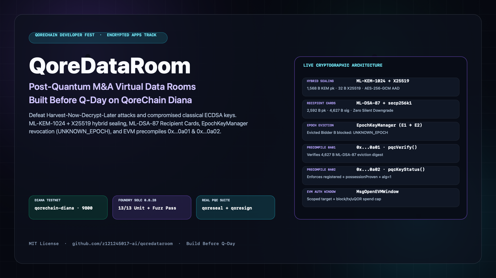
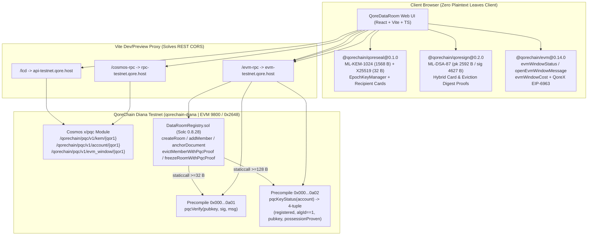
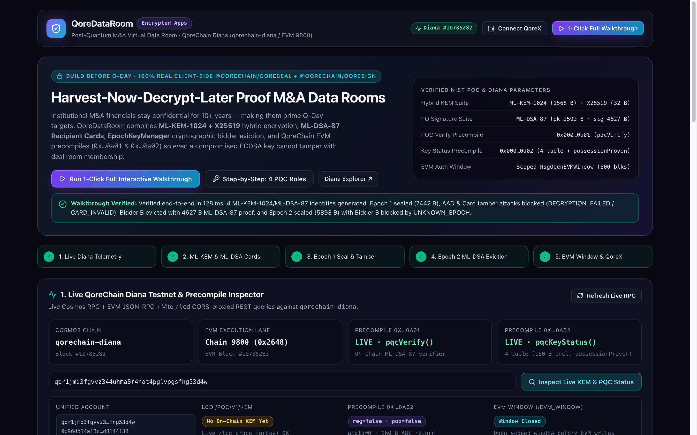

# QoreDataRoom

> **Post-Quantum M&A Virtual Data Rooms built natively for QoreChain Diana ("Build Before Q-Day")**
>
> **Primary Track:** `Encrypted Apps` · **Special Awards:** `Best AI-Native Build` & `Top-Quality Awards` · **License:** MIT



---

## Why QoreDataRoom?

Institutional M&A due diligence documents — audited financials, customer concentration tables, and binding valuation models — remain confidential for **10–15+ years**. That makes M&A virtual data rooms (VDRs) prime targets for **two Q-Day threats today**:

1. **Harvest-Now-Decrypt-Later (HNDL):** Adversaries archiving classical TLS/RSA/ECIES encrypted deal-room payloads today can decrypt them once fault-tolerant quantum computers arrive.
2. **Compromised Classical ECDSA Governance Keys:** If an attacker compromises a Deal Owner's classical secp256k1 key, classical EVM access-control contracts allow them to silently add rogue bidders or rotate deal-room permissions.

**QoreDataRoom** solves both end-to-end on **QoreChain** using **100% real NIST post-quantum cryptography** (`ML-KEM-1024 + X25519` hybrid sealing, `ML-DSA-87` Recipient Cards, `EpochKeyManager` dynamic revocation) anchored to **QoreChain's live EVM PQC precompiles (`0x...0a01` & `0x...0a02`)**.

---

## System Architecture



---

## Key Features & Killer Q-Day Capability

### 1. On-Chain ML-DSA-87 Gated Eviction & Emergency Freeze (`contracts/src/DataRoomRegistry.sol`)
- **Strict 4-Tuple Precompile Gate (`0x...0a02`):** Every `registerKemCommitment`, `createRoom`, and `addMember` call verifies `registered && possessionProven && algorithmId == 1` (ML-DSA-87) via a length-guarded `staticcall` (`ok && ret.length >= 128`). Missing or truncated precompile returns fail closed.
- **Quantum-Resistant Eviction (`evictMemberWithPqcProof`):** Evicting a competing bidder and advancing `currentEpoch` requires a valid **4,627-byte ML-DSA-87 signature** from the Deal Owner verified directly on-chain by precompile `0x0000000000000000000000000000000000000a01` over the domain-separated digest:
  ```solidity
  keccak256(abi.encode(
      "QOREDATAROOM_EVICT_V1",
      block.chainid,
      address(this),
      roomId,
      member,
      nextEpoch,
      newEpochRootHash,
      nonce
  ))
  ```
  Even if the Deal Owner's classical ECDSA key is compromised, the attacker **cannot** alter room membership or rotate epochs.
- **Cold-Key Emergency Freeze (`freezeRoomWithPqcProof`):** Allows freezing a deal room with a domain-separated `QOREDATAROOM_FREEZE_V1` ML-DSA-87 signature relayed by any account.

### 2. Real Client-Side Post-Quantum Data Room (`web/src/lib/pqcDataRoom.ts`)
- **Zero Mocked Crypto:** Runs real `@qorechain/qoreseal@0.1.0` and `@qorechain/qoresign@0.2.0` primitives directly in the browser.
- **1-Click Full Interactive Walkthrough for Judges:**
  1. **Live Diana Telemetry:** Queries live block height (`qorechain-diana`), EVM chainId (`9800` / `0x2648`), precompile liveness (`0x...0a01` & 160-byte 4-tuple `0x...0a02`), and live `/lcd/qorechain/pqc/v1/kem/{qor1}` lookup for any address (defaulting to `qor1jmd3fgvvz344uhma8r4nat4pglvpgsfng53d4w`).
  2. **4-Role PQC Identity Minting:** Generates real ML-KEM-1024 (`1568 B` pk) + X25519 (`32 B`) + ML-DSA-87 (`2592 B` pk) keys and hybrid-signed Recipient Cards (`ml-dsa-87-hybrid`) for **Deal Owner**, **Bidder A — Apex Capital**, **Bidder B — Meridian Ventures**, and **Independent Auditor**. Strictly verifies cards (`verifyRecipientCard`) with zero silent downgrade — includes a live **MITM Card Tamper Attack** button proving `CARD_INVALID`.
  3. **Epoch 1 Confidential Financials:** Seals `Q3_Financials_Confidential.md` (or any custom memo / uploaded `.txt`/`.md` file) bound to `chainId = "qorechain-diana"`, `purpose = "qoredataroom:v1:document"`, and `AAD = qoredataroom|room=...|epoch=1|sha256=...`. All 4 roles decrypt cleanly; **AAD Tamper Attack** proves `DECRYPTION_FAILED`.
  4. **Epoch 2 ML-DSA-87 Eviction of Bidder B:** Signs the exact Solidity `QOREDATAROOM_EVICT_V1` digest with the Deal Owner's real ML-DSA-87 key (`4627 B` sig, `pqVerify = true`), calls `EpochKeyManager.removeMember("bidder-b")` to rotate to Epoch 2, and seals `Final_Valuation_Model_v2.md`. Proves live that **Deal Owner, Bidder A, and Auditor decrypt Epoch 2 seamlessly**, while **Bidder B still reads Epoch 1 yet is cryptographically blocked on Epoch 2 with `UNKNOWN_EPOCH`** (and `NOT_A_RECIPIENT` on the Epoch 2 key distribution envelope).
  5. **Scoped EVM Window & QoreX Wallet Panel:** Real `@qorechain/evm` `openEvmWindowMessage` (`allowedTargets: [DataRoomRegistry]`, `blocks: 600`, `maxTxs: 20`) + `evmWindowCost` + `@qorechain/qoreseal` `buildRegisterKemKeyMessage` + direct `window.qorex.native` & EIP-6963 (`rdns === "network.qore.qorex"`) connection (deliberately avoiding broken `@qorechain/react` `useTx`).

---

## Verified Cryptographic & Security Proof Matrix

| Security Property | Mechanism / Package | Verified Evidence |
| --- | --- | --- |
| **Hybrid KEM Envelope** | `@qorechain/qoreseal` `seal` / `open` | ML-KEM-1024 (`1568 B` pk / `1568 B` ct) + X25519 (`32 B`) + AES-256-GCM; real `qoreseal:...` envelope (`7442 B` for 4 recipients, `5893 B` for 3) |
| **Zero Silent Downgrade on Recipient Cards** | `@qorechain/qoreseal` `signRecipientCard` / `verifyRecipientCard` | Hybrid `ml-dsa-87-hybrid` card; 1-byte X25519 mutation rejected with `QoreSealError: CARD_INVALID` |
| **Authenticated Metadata (AAD)** | `AAD = qoredataroom\|room=...\|epoch=...\|sha256=...` | Modified AAD rejected with `QoreSealError: DECRYPTION_FAILED` |
| **Cryptographic Revocation (Forward Secrecy)** | `@qorechain/qoreseal` `EpochKeyManager.removeMember` | Evicted Bidder B reads Epoch 1, gets `NOT_A_RECIPIENT` on Epoch 2 key distribution and `UNKNOWN_EPOCH` on Epoch 2 documents |
| **On-Chain ML-DSA-87 Eviction Proof** | `@qorechain/qoresign` `pqSign` / `pqVerify` + `0x...0a01` | `4627 B` ML-DSA-87 signature over exact Solidity `QOREDATAROOM_EVICT_V1` ABI digest; forged sig & replayed nonce revert |
| **On-Chain Possession-Proven Key Gate** | `QorePQCLib.sol` + `0x...0a02` (4-tuple, `>=128 B`) | Rejects unregistered accounts, `possessionProven == false`, `algorithmId != 1`, and empty precompile return bytes |
| **Smart Contract Fuzz Resistance** | Foundry Solc `0.8.28` (`deny = "warnings"`) | `13/13` tests pass (`9` unit + `4` fuzz suites × `256` runs = `1,024` fuzz executions), `0` compiler warnings |
| **Live Browser QA** | Headless Chrome CDP (`scripts/qa_capture.mjs`) | `0` page errors, `0` console errors, `0` horizontal overflow at `1440×900`, `120 ms` full walkthrough |

---

## QoreChain Diana Testnet Parameters & Deployment Status

| Parameter | Verified Value |
| --- | --- |
| **Cosmos Chain ID** | `qorechain-diana` |
| **EVM Chain ID** | `9800` (`0x2648`) |
| **Cosmos RPC** | `https://rpc-testnet.qore.host` |
| **Cosmos REST (LCD)** | `https://api-testnet.qore.host` (proxied via Vite `/lcd` to bypass missing browser CORS) |
| **EVM JSON-RPC** | `https://evm-testnet.qore.host` |
| **Block Explorer** | `https://explore.qore.network` |
| **Precompile `pqcVerify`** | `0x0000000000000000000000000000000000000a01` (live-probed) |
| **Precompile `pqcKeyStatus`** | `0x0000000000000000000000000000000000000a02` (live-probed: returns 160 B 4-tuple incl. `possessionProven`) |
| **Registered Demo Account** | `qor1jmd3fgvvz344uhma8r4nat4pglvpgsfng53d4w` / `0x96db14a18c146b5e5f7d38eb3eaea147d8144133` |

### Diana Testnet Deployment Record

| Artifact | Network | Status / Address / Tx Hash |
| --- | --- | --- |
| `DataRoomRegistry.sol` | QoreChain Diana EVM (`9800`) | `[Pending live Diana broadcast]` |
| `MsgOpenEVMWindow` (Scoped) | QoreChain Diana Native (`qorechain-diana`) | `[Pending live Diana broadcast]` |
| `MsgRegisterKEMKey` (ML-KEM-1024) | QoreChain Diana Native (`qorechain-diana`) | `[Pending live Diana broadcast]` |

> **Honesty Note:** No private keys are stored in this repository or accessed during automated testing. To broadcast live onto Diana Testnet, follow the 2-step command sequence below.

### Deploy Live to Diana Testnet (2 Steps)

1. **Open a Scoped EVM Authorization Window** via QoreX Wallet (`window.qorex.native.signAndBroadcast`) using the `MsgOpenEVMWindow` payload rendered in Section 5 of the web UI (or `@qorechain/sdk` `EthNativeSigner`).
2. **Deploy `DataRoomRegistry` via Foundry** (reads `PRIVATE_KEY` strictly at runtime via `vm.envUint("PRIVATE_KEY")`):
   ```bash
   cd contracts
   PRIVATE_KEY=0x<YOUR_FUNDED_DIANA_PRIVATE_KEY> \
     forge script script/DeployDiana.s.sol:DeployDiana \
     --rpc-url https://evm-testnet.qore.host \
     --broadcast --legacy
   ```

---

## 1-Command Local Reproduction

### Smart Contracts (Foundry)
```bash
cd contracts && forge test -vv
```

### Real Post-Quantum Crypto Tests & Production Web Build
```bash
cd web && npm install && npm test && npm run build
```

### Run Interactive Web App (with Live Diana `/lcd` Proxy)
```bash
cd web && npm run dev
# Open http://127.0.0.1:5173 and click "1-Click Full Walkthrough"
```

### Run Live Headless Chrome QA Verification
```bash
node scripts/qa_capture.mjs
```

---

## Live Application Preview



---

## Official QoreChain Packages Credited

- `@qorechain/qoreseal@0.1.0` — FIPS 203 ML-KEM-1024 + X25519 hybrid envelopes, ML-DSA-87 Recipient Cards, `EpochKeyManager`, `sealBatch` / `openBatch`, and `buildRegisterKemKeyMessage`.
- `@qorechain/qoresign@0.2.0` — FIPS 204 ML-DSA-87 key derivation, signing, verification (`pqKeyFromSeed`, `pqSign`, `pqVerify`), and unified `eth_secp256k1` `qor1`/`0x` address derivation.
- `@qorechain/evm@0.14.0` — `evmWindowStatus`, `openEvmWindowMessage`, `evmWindowCost`, `toQorAddress`, `toEvmAddress`, and chain definitions.
- `@qorechain/sdk@0.14.0` & `@qorechain/pqc@0.2.3` — QoreChain protocol constants & post-quantum primitives.

See [AI_USAGE.md](AI_USAGE.md) for the complete AI-native engineering log and real-world protocol bugs discovered and fixed during development.
